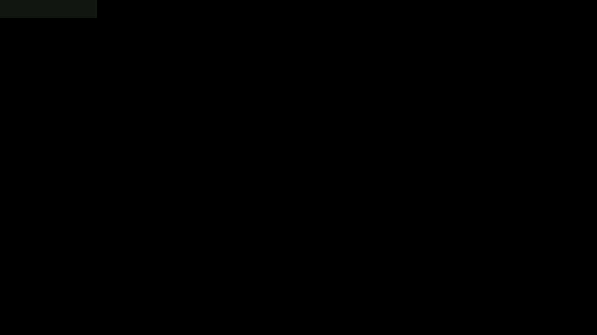
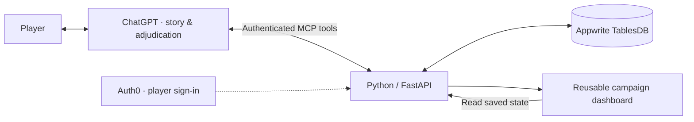

<p align="center">
  
</p>

<p align="center">
  Play a tabletop-style RPG in ChatGPT, with a saved dashboard for your character and campaign.
</p>

<p align="center">
  <a href="#start-playing">Start playing</a> ·
  <a href="#what-it-does">Dashboard</a> ·
  <a href="#how-it-works">How it works</a> ·
  <a href="#developer-setup">Developer setup</a> ·
  <a href="PROJECT_PROFILE.md">Portfolio & resume</a>
</p>

DnDGPT puts character stats, abilities, summons, equipment and campaign history in one reusable dashboard beside the conversation. The GM saves resolved changes through authenticated tools, so the interface can reopen the latest record without rebuilding a status panel every turn.

## Start playing

**Connect DnDGPT to your ChatGPT account, sign in, and load the rules to start playing.** Your DnDGPT login keeps your campaign saves private.

This is a one-time manual connection. DnDGPT is not listed in ChatGPT's public directory yet. Your ChatGPT account must offer **Add custom MCP server**; if that option is missing, this installation route is unavailable on your account.

### 1. Add DnDGPT to ChatGPT

Open **Plugins → + → Add custom MCP server**. Set the name to **DnDGPT**, choose **OAuth**, and paste this server URL:

```text
https://dndgpt-deonholo.fra.appwrite.run/mcp
```

### 2. Fill in the sign-in settings

Open the advanced OAuth settings. Choose **User-Defined OAuth Client**, then copy these values:

| Field | Value |
| --- | --- |
| Client ID | `0vMIwqvc8C7y68Mf1P4BLMcVii38ETri` |
| Token authentication method | **None** |
| Client secret | Leave empty |
| Scopes | `campaign:read` and `campaign:write` |
| Base scopes | `offline_access` |
| OpenID Connect / OIDC | **Off** |

The client ID is public connection information, not a password.

<details>
<summary>If ChatGPT asks for authorization and token URLs</summary>

| Field | Value |
| --- | --- |
| Authorization URL | `https://dev-ixieupunvjp8krl6.us.auth0.com/authorize` |
| Token URL | `https://dev-ixieupunvjp8krl6.us.auth0.com/oauth/token` |
| Resource | `https://dndgpt-deonholo.fra.appwrite.run/mcp` |

</details>

### 3. Connect and sign in

Review the requested access, click **Create as a plugin**, then **Connect**. On the DnDGPT sign-in page, choose **Sign up** if you are new, or use your existing DnDGPT login.

That page uses Auth0 to handle DnDGPT sign-in. You are creating a player account, not an Auth0 developer account. When ChatGPT shows **Connected**, you are ready.

### 4. Load the rules and start a chat

Download the [DnDGPT rulebook](https://raw.githubusercontent.com/DeonHolo/DnDGPT/main/dndgpt-app/rules/rulebook-v1.0.txt) and [Rule Hardener](https://raw.githubusercontent.com/DeonHolo/DnDGPT/main/dndgpt-app/rules/rule-hardener.txt) as `.txt` files. Click **Try in chat**, use regular **Chat** mode, and attach both files. You can attach your own complete rulebook fork instead of the standard rulebook.

Send this to begin:

> Act as my DnDGPT GM using the attached rules. Begin character creation and open my campaign dashboard. Save our progress and keep the dashboard updated as we play. Ask for character confirmation and starting the adventure separately.

The connection provides the dashboard and save tools; the attached files provide the rules. After a saved choice, you can say **“Open my campaign dashboard.”** Updates appear when ChatGPT saves the result; narration alone does not update it.

<details>
<summary>Already connected, using custom rules, or having trouble?</summary>

- **Already says Connected?** Click **Try in chat**. You do not need to create another connection.
- **Custom rulebook?** Attach your full version and tell the GM it takes precedence. Extra systems can use supported save fields; they do not automatically add dashboard tabs.
- **Blank dashboard?** Ask ChatGPT to save your current character choices, then open your campaign dashboard.
- **App unavailable or old layout?** Reload ChatGPT. If needed, open the DnDGPT connection's settings, select **Refresh tools**, then reload again.

</details>

## What it does

- **A saved character sheet.** Resource meters, progression, conditions and saved character choices.
- **Details when you need them.** Ability subtabs, expandable mechanics, equipment/inventory, allies/combat and world/log views.
- **Durable campaign records.** Account ownership, partial updates, version checks and event history.
- **Real rolls, stable receipts.** Reusable Python dice, checks and rarity tools; retrying the same action returns the saved result.
- **A complete rulebook.** Edition 1.0 rules and the originality hardener ship with the GM skill. ChatGPT handles narration and most adjudication.
- **Explicit session control.** Character confirmation and starting the adventure are separate approvals. Browsing panels does not advance play.



<sub>Current dark-mode interface, captured with disposable demo data in the local host simulator. No player save or private account is shown.</sub>

<details>
<summary><strong>Inside the seven chapters</strong></summary>

| Chapter | Contents |
| --- | --- |
| Character & Progression | Attributes, class, title, experience and advancement |
| Skills & Class Abilities | Combat, reactions, passives and utility |
| Health & Conditions | HP, MP, stamina, defenses and status effects |
| Allies & Combat | Companions, summons, enemies and encounter records |
| Equipment & Inventory | Equipped gear, stored items and supplies |
| Quest Journal | Objectives, discoveries and rewards |
| World & Campaign Log | World reference and the story so far |

</details>

## How it works

**Python · FastAPI · JavaScript · MCP / MCP Apps · Auth0 OAuth 2.0 / PKCE · Appwrite Functions / TablesDB**



The dashboard reads **saved tool updates**, not the chat transcript. After resolving a turn, the GM calls `save_chat_update`; the dashboard reads the committed state. Narration uses regular ChatGPT. The backend has no model-inference API client.

The project began as a local FastAPI/SQLite service exposed through tunnels, later using a fixed ngrok address. The hosted version runs on **Appwrite Functions and TablesDB**, using resources from the **GitHub Student Developer Pack**. Auth0 still handles player sign-in. New hosted games work independently of the creator's PC.

## Developer setup

The sections below are for people who want to build or host their own instance. Players can use [Start playing](#start-playing).

### Host on Appwrite

The Python Function serves the backend and the MCP App dashboard resource. A separate website is optional. See the [Appwrite deployment guide](dndgpt-app/APPWRITE_HOSTING.md) and [authentication setup](dndgpt-app/AUTH0_SETUP.md).

**Deployment flow:** develop locally → run relevant tests → push to `main` → Appwrite builds changes under `dndgpt-app/**` → the stable domain serves the new deployment.

Automatic GitHub test CI is **not configured**. Appwrite provides automatic deployment; tests currently run before pushing. GM instructions and packaged rulebooks need a new plugin version and distribution step. Backend/dashboard changes keep the same server address. ChatGPT can retain older dashboard HTML: refresh the app's tools in Settings, then reload the ChatGPT page to fetch the new layout.

**Current status:** cloud-hosted private beta. Real Appwrite fixture checks and the creator's ChatGPT sign-in, save, display and reopen flow have passed. Independent-player installation and public-directory publication remain separate acceptance steps.

### Package your own ChatGPT integration

1. Deploy the service at a reachable HTTPS address with durable storage.
2. Configure OAuth and the matching protected resource using the [authentication guide](dndgpt-app/AUTH0_SETUP.md).
3. Create a supported custom MCP App connection in ChatGPT and sign in.
4. Copy the [App connection template](dndgpt-system-rebirth/.app.example.json) to `.app.json` beside it, replacing the placeholder with your actual App ID.
5. Build with `python dndgpt-app/scripts/build_plugin.py`, then verify saving, dashboard rendering and reopening in the actual client.

Players connecting to an existing hosted instance need their ChatGPT account and a DnDGPT sign-in. They do not need their own Appwrite, Auth0 developer or ngrok account.

This repository contains source and connection templates. ChatGPT account capabilities and distribution permissions still apply.

### Run locally

Python 3.12 or newer:

```sh
python -m venv .venv
# Windows PowerShell: .\.venv\Scripts\Activate.ps1
# macOS/Linux: source .venv/bin/activate
python -m pip install -r dndgpt-app/requirements.txt
cd dndgpt-app
python -m pytest -q
python -m uvicorn app.server:app --host 127.0.0.1 --port 8765
```

Health: `http://127.0.0.1:8765/api/health`. Protected tools require OAuth configuration. Starting localhost alone does not connect it to ChatGPT.

For a **disposable UI simulator**, run from `dndgpt-app`:

```sh
python -m uvicorn tests.host_harness:app --host 127.0.0.1 --port 8766
```

Open `http://127.0.0.1:8766/test-host`. It uses generated test credentials and a temporary database. Keep it local. It tests UI behavior separately from ChatGPT compatibility.

## Validation and scope

Automated tests cover authentication, ownership, transactional updates, duplicate retries, saved rolls, recovery, rule integrity and packaging. Browser interaction checks and hosted ChatGPT acceptance are recorded separately in the [acceptance notes](dndgpt-app/CLIENT_ACCEPTANCE.md).

Current evidence does not establish production uptime, player capacity, measured latency, complete executable rule coverage or public-directory approval. Credentials, private connection IDs, campaign databases and personal playthroughs are excluded from this repository.

## Project map

| Path | Purpose |
| --- | --- |
| `dndgpt-app/app/` | API, MCP tools, storage and dashboard |
| `dndgpt-app/rules/` | Complete rules, amendments and integrity manifest |
| `dndgpt-app/tests/` | Automated checks and disposable host simulator |
| `dndgpt-app/scripts/` | Packaging, rule audits and backup tools |
| [Game Master skill](dndgpt-system-rebirth/skills/game-master/SKILL.md) | GM instructions and packaged rule references |
| [PROJECT_PROFILE.md](PROJECT_PROFILE.md) | Architecture history, skills and resume wording |

Created by **Deon Holo**, with AI-assisted development using Codex and ChatGPT. See [CHAT_LED_PLAY.md](dndgpt-app/CHAT_LED_PLAY.md) and [RULES_COVERAGE.md](dndgpt-app/RULES_COVERAGE.md) for implementation detail.

Logo downloads: [transparent PNG](docs/images/dndgpt-logo.png) · [dark square PNG](docs/images/dndgpt-logo-dark.png) · [SVG](docs/images/dndgpt-dice.svg).
