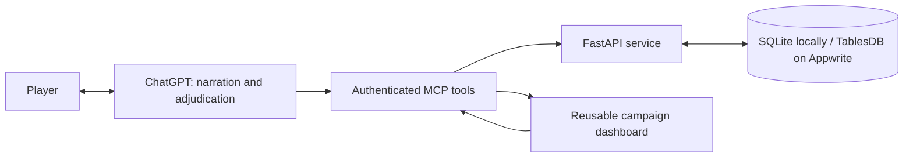

# DnDGPT

**A persistent RPG companion for conversations with ChatGPT.**

ChatGPT runs the story. DnDGPT keeps the character sheet, powers, inventory and world record in a reusable fantasy dashboard beside the conversation. It replaces repeated status-panel generation with one interface backed by saved state.

Built with **Python, FastAPI, SQLite / Appwrite TablesDB, OAuth 2.0 / PKCE, MCP, MCP Apps and JavaScript**. Normal GM narration stays in ChatGPT; the backend has no model-inference API client.

## What it does

- Seven dashboard chapters with compact navigation summaries, resource meters, nested details and subtabs for abilities, equipment/inventory, summons/combat and world/log.
- Account-owned records, batched partial updates, optimistic version checks and transactional event history.
- Reusable Python dice, checks and rarity rolls with stable receipts: retrying an action does not create a replacement roll.
- Authenticated MCP tools and an MCP App interface, shared with the FastAPI service.
- Complete edition 1.0 rulebook and hardener, with integrity tests for preserved source and authorized additive revisions.
- Separate character confirmation and adventure authorization, with no gameplay mutation when browsing panels.



The dashboard displays tool-saved data. It does not read the conversation by itself: the GM saves a resolved turn through `save_chat_update`, and the view reads that committed state. Most mechanics are interpreted by ChatGPT; a complete executable rules engine is not required for this mode.

## Run locally

Python 3.12 or newer:

```sh
python -m venv .venv
# Windows PowerShell: .\.venv\Scripts\Activate.ps1
# macOS/Linux: source .venv/bin/activate
python -m pip install -r dndgpt-app/requirements.txt
cd dndgpt-app
python -m pytest -q
python -m uvicorn app.server:app --host 127.0.0.1 --port 8765
```

Health: `http://127.0.0.1:8765/api/health`. Protected tools require an OAuth configuration; starting localhost alone does not create a connected ChatGPT dashboard.

For a **disposable interface simulator**, run from `dndgpt-app`:

```sh
python -m uvicorn tests.host_harness:app --host 127.0.0.1 --port 8766
```

Open `http://127.0.0.1:8766/test-host`. This uses generated test credentials and a temporary fixture database. Never expose this test server publicly. It demonstrates UI behavior, not ChatGPT client compatibility.

## Host on Appwrite

The service can run as an Appwrite Python Function with private transactional TablesDB records. The dashboard is an MCP App resource inside ChatGPT; a separate website is optional. GitHub supplies source and deployments. See [Appwrite deployment configuration](dndgpt-app/APPWRITE_HOSTING.md).

A real Appwrite fixture probe passed 14 save/reopen, retry, approval and isolation checks. A separate private connection in regular ChatGPT passed OAuth sign-in, disposable save, actual dashboard display, page reload and fresh readback. Second-account installation and public directory publication remain pending. This is not a player-capacity or uptime benchmark.

The current deployment branch is `appwrite-hosting`, with `dndgpt-app` as the Function root. Pushes affecting `dndgpt-app/**` trigger builds and update the branch-bound domain; two code pushes verified this path. Automatic GitHub test CI is not configured, so this is automatic deployment without a test gate. Packaged GM instructions/rulebooks require a new plugin version and distribution step. Backend/dashboard resource updates keep the stable server address; an open view may need reopening to fetch changed HTML.

## Connect your own ChatGPT App

1. Host the service at a reachable HTTPS address with durable database storage.
2. Configure an OAuth provider and the matching protected resource. See [authentication setup](dndgpt-app/AUTH0_SETUP.md).
3. Create a supported private MCP App connection in your ChatGPT client and complete sign-in.
4. Copy `dndgpt-system-rebirth/.app.example.json` to `.app.json` in the same folder; replace the placeholder with your actual App ID.
5. Build the plugin with `python dndgpt-app/scripts/build_plugin.py`, then verify rendering, saving and reopening in the actual client.

Client availability, display modes and distribution permissions belong to ChatGPT. This repository is source code and a connection template; it is not an automatically installed public plugin. The legacy `dndgpt-system-rebirth` folder/manifest ID remains for package compatibility; the portfolio project is **DnDGPT**.

## Validation and scope

The automated suite covers ownership, token validation, transactional updates, duplicate retries, saved rolls, process persistence, rules integrity and packaging. The browser harness exercises dashboard interactions separately.

The private installation has also been exercised in regular ChatGPT with authenticated saves and a reusable companion view. Those account-specific records and screenshots are intentionally excluded here. Local tests do not establish public-directory approval, every client display mode, multi-user acceptance, production uptime or latency benchmarks. See [acceptance boundaries](dndgpt-app/CLIENT_ACCEPTANCE.md).

No credentials, live connection IDs, campaign databases or private playthroughs are included. Personal Windows startup/tunnel installation files are also excluded; configure hosting for your own environment.

## Project map

| Path | Purpose |
| --- | --- |
| `dndgpt-app/app/` | API, MCP, storage, supported mechanics and reusable dashboard |
| `dndgpt-app/rules/` | Complete rules, amendment ledger and integrity manifest |
| `dndgpt-app/tests/` | Automated tests and disposable host simulator |
| `dndgpt-app/scripts/` | Plugin packaging, rule audits and database backup tooling |
| `dndgpt-system-rebirth/skills/` | GM skill and complete packaged rule references |
| [PROJECT_PROFILE.md](PROJECT_PROFILE.md) | Short portfolio and resume wording |

The project remains in active development. Detailed implementation notes are in [CHAT_LED_PLAY.md](dndgpt-app/CHAT_LED_PLAY.md) and [RULES_COVERAGE.md](dndgpt-app/RULES_COVERAGE.md).
