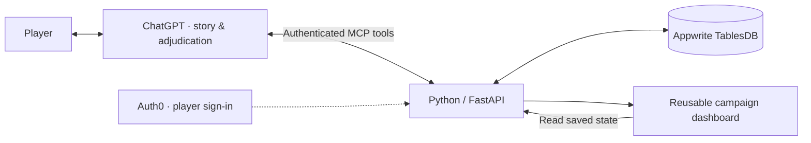

<p align="center">
  
</p>

<p align="center">
  A heavily customized, D&D 5e-inspired homebrew RPG, with ChatGPT as your GM and a saved campaign dashboard.
</p>

<p align="center">
  <a href="#start-playing">Start playing</a> ·
  <a href="#what-it-does">Dashboard</a> ·
  <a href="#how-it-works">How it works</a> ·
  <a href="#package-your-own-chatgpt-integration">Build your own</a> ·
  <a href="PROJECT_PROFILE.md">Portfolio & resume</a>
</p>

DnDGPT is a heavily customized fantasy homebrew RPG inspired by D&D 5e, not a standard 5e ruleset. Its original rules, classes and progression reflect the creator's preferences. ChatGPT runs the adventure, while a reusable dashboard tracks character stats, abilities, allies, equipment and campaign history beside the conversation.

## Start playing

**Connect DnDGPT, sign in, and start a chat.** The standard rulebook and Rule Hardener are available through the connection; no TXT uploads are needed. Your DnDGPT login keeps your campaign saves private.

**Cost and ChatGPT plans:** DnDGPT is free to use, with no DnDGPT subscription, API key or API-credit purchase required. Free ChatGPT users can play when their account offers the required plugin/custom MCP connection. A paid ChatGPT plan is recommended for longer sessions because of its larger usage allowance; normal ChatGPT model and tool limits still apply. Connection availability can vary by account and workspace, so check for the setup option below. See [OpenAI's plugin guide](https://learn.chatgpt.com/docs/plugins) and [current plans and limits](https://learn.chatgpt.com/docs/pricing).

This is a one-time manual connection. DnDGPT is not listed in ChatGPT's public directory yet. Your ChatGPT account must offer **Add custom MCP server**; if that option is missing, this installation route is unavailable on your account.

### 1. Add DnDGPT to ChatGPT

Open **Plugins → + → Add custom MCP server**. Set the name to **DnDGPT**, choose **OAuth**, and paste this server URL:

```text
https://dndgpt-deonholo.fra.appwrite.run/mcp
```

### 2. Fill in the sign-in settings

Open the advanced OAuth settings. Choose **User-Defined OAuth Client**, then copy these values:

| Field | Value |
| --- | --- |
| Client ID | `0vMIwqvc8C7y68Mf1P4BLMcVii38ETri` |
| Token authentication method | **None** |
| Client secret | Leave empty |
| Scopes | `campaign:read` and `campaign:write` |
| Base scopes | `offline_access` |
| OpenID Connect / OIDC | **Off** |

The client ID is public connection information, not a password.

<details>
<summary>If ChatGPT asks for authorization and token URLs</summary>

| Field | Value |
| --- | --- |
| Authorization URL | `https://dev-ixieupunvjp8krl6.us.auth0.com/authorize` |
| Token URL | `https://dev-ixieupunvjp8krl6.us.auth0.com/oauth/token` |
| Resource | `https://dndgpt-deonholo.fra.appwrite.run/mcp` |

</details>

### 3. Connect and sign in

Review the requested access, click **Create as a plugin**, then **Connect**. On the DnDGPT sign-in page, choose **Sign up** if you are new, or use your existing DnDGPT login.

That page uses Auth0 to handle DnDGPT sign-in. When ChatGPT shows **Connected**, you are ready.

### 4. Start a campaign

Click **Try in chat** and use regular **Chat** mode. DnDGPT provides the complete standard rulebook and Rule Hardener directly. You do not need to download or attach them for standard play.

Send this to begin:

> Be my DnDGPT GM. Read the complete standard rulebook and Rule Hardener from the plugin or connected tools, then begin character creation and open my campaign dashboard. Save our progress as we play. Ask for character confirmation and starting the adventure separately.

After a saved choice, you can say **“Open my campaign dashboard.”** Updates appear when ChatGPT saves the result; narration alone does not update it.

> **Thinking tip:** Use a higher thinking level for character creation, level-ups and complex rules decisions. Instant or Medium is usually enough for regular gameplay. Use whichever of these settings your ChatGPT model offers; this is a recommendation, not a requirement.

<details>
<summary>Already connected, using custom rules, or having trouble?</summary>

- **Already says Connected?** Click **Try in chat**. You do not need to create another connection.
- **Connected before hosted rules were added?** Open the connection's settings, select **Refresh tools**, then start a fresh chat. The `read_rules` tool supplies both complete documents in pages.
- **Custom rulebook?** Attach your full version and tell the GM it takes precedence. Extra systems can use supported save fields; they do not automatically add dashboard tabs.
- **Want to read or fork the rules?** The [rulebook](https://raw.githubusercontent.com/DeonHolo/DnDGPT/main/dndgpt-app/rules/rulebook-v1.0.txt) and [Rule Hardener](https://raw.githubusercontent.com/DeonHolo/DnDGPT/main/dndgpt-app/rules/rule-hardener.txt) are available separately as optional downloads.
- **Blank dashboard?** Ask ChatGPT to save your current character choices, then open your campaign dashboard.
- **App unavailable or old layout?** Reload ChatGPT. If needed, open the DnDGPT connection's settings, select **Refresh tools**, then reload again.

</details>

## What it does

Development plans and completed requests: [project checklist](ROADMAP.md).

- **A saved character sheet.** Resource meters, progression, conditions and saved character choices.
- **Details when you need them.** Expand an ability to inspect its mechanics; use the Combat, Reactions, Passives and Utility tabs alongside equipment/inventory, allies/combat and world/log chapters.
- **Durable campaign records.** Account ownership, partial updates, version checks and event history.
- **Campaign cleanup.** Ask ChatGPT to preview a save and confirm permanent deletion. This control is in the connected chat tools, not the dashboard; a small marker remains to stop stale retries from restoring it.
- **Real rolls, stable receipts.** Reusable Python dice, checks and rarity tools; retrying the same action returns the saved result.
- **The rules are included.** The complete custom rulebook and originality hardener ship with the GM skill and are readable through the hosted connection. ChatGPT handles narration and most adjudication.
- **Explicit session control.** Character confirmation and starting the adventure are separate approvals. Browsing panels does not advance play.

**Standalone dashboard**


**Inside ChatGPT**


<details>
<summary><strong>Inside the seven chapters</strong></summary>

| Chapter | Contents |
| --- | --- |
| Character & Progression | Attributes, class, title, experience and advancement |
| Skills & Class Abilities | Combat, reactions, passives and utility |
| Health & Conditions | HP, MP, defenses and status effects |
| Allies & Combat | Companions, summons, enemies and encounter records |
| Equipment & Inventory | Equipped gear, stored items and supplies |
| Quest Journal | Objectives, discoveries and rewards |
| World & Campaign Log | World reference and the story so far |

</details>

## How it works

**Python · FastAPI · JavaScript · MCP / MCP Apps · Auth0 OAuth 2.0 / PKCE · Appwrite Functions / TablesDB**



The dashboard reads **saved tool updates**, not the chat transcript. After resolving a turn, the GM calls `save_chat_update`; the dashboard reads the committed state. Narration uses regular ChatGPT. The backend has no model-inference API client.

The hosted service runs on **Appwrite Functions and TablesDB**, with Auth0 handling sign-in. Each player's saves are private to their own account.

## Package your own ChatGPT integration

This section is for developers building their own private instance. Players can start with [Start playing](#start-playing).

1. Deploy the service at a reachable HTTPS address with durable storage.
2. Configure OAuth and the matching protected resource using the [authentication guide](dndgpt-app/AUTH0_SETUP.md).
3. Create a supported custom MCP App connection in ChatGPT and sign in.
4. Copy the packaged `.app.example.json` connection template to `.app.json` beside it, replacing the placeholder with your actual App ID.
5. Build with `python dndgpt-app/scripts/build_plugin.py`, then verify saving, dashboard rendering and reopening in the actual client.

Players connecting to an existing hosted instance need only their ChatGPT account and a DnDGPT sign-in.

This repository contains source and connection templates. ChatGPT account capabilities and distribution permissions still apply.

### Run locally

Python 3.12 or newer:

```sh
python -m venv .venv
# Windows PowerShell: .\.venv\Scripts\Activate.ps1
# macOS/Linux: source .venv/bin/activate
python -m pip install -r dndgpt-app/requirements.txt
cd dndgpt-app
python -m pytest -q
python -m uvicorn app.server:app --host 127.0.0.1 --port 8765
```

Health: `http://127.0.0.1:8765/api/health`. Protected tools require OAuth configuration. Starting localhost alone does not connect it to ChatGPT.

For a **disposable UI simulator**, run from `dndgpt-app`:

```sh
python -m uvicorn tests.host_harness:app --host 127.0.0.1 --port 8766
```

Open `http://127.0.0.1:8766/test-host`. It uses generated test credentials and a temporary database. Keep it local. It tests UI behavior separately from ChatGPT compatibility.

## Validation and scope

Automated tests cover authentication, ownership, transactional updates, duplicate retries, saved rolls, recovery, rule integrity and packaging. Browser interaction checks and hosted ChatGPT acceptance are recorded separately in the [acceptance notes](dndgpt-app/CLIENT_ACCEPTANCE.md).

Current evidence does not establish production uptime, player capacity, measured latency, complete executable rule coverage or public-directory approval. Credentials, private connection IDs, campaign databases and personal playthroughs are excluded from this repository.

## Project map

| Path | Purpose |
| --- | --- |
| `dndgpt-app/app/` | API, MCP tools, storage and dashboard |
| `dndgpt-app/rules/` | Complete rules, amendments and integrity manifest |
| `dndgpt-app/tests/` | Automated checks and disposable host simulator |
| `dndgpt-app/scripts/` | Packaging, rule audits and backup tools |
| [PROJECT_PROFILE.md](PROJECT_PROFILE.md) | Architecture history, skills and resume wording |

Created by **Deon Holo**, with AI-assisted development using Codex and ChatGPT. See [CHAT_LED_PLAY.md](dndgpt-app/CHAT_LED_PLAY.md) and [RULES_COVERAGE.md](dndgpt-app/RULES_COVERAGE.md) for implementation detail.

## Support development

[](https://www.paypal.com/paypalme/deonholo)

Contributions are optional and do not unlock features or affect gameplay.

Logo downloads: [transparent PNG](docs/images/dndgpt-logo.png) · [dark square PNG](docs/images/dndgpt-logo-dark.png) · [SVG](docs/images/dndgpt-dice.svg).
