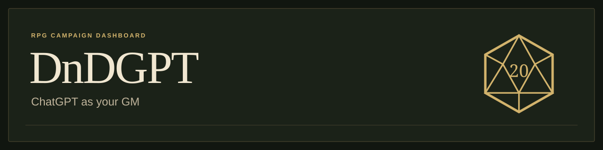
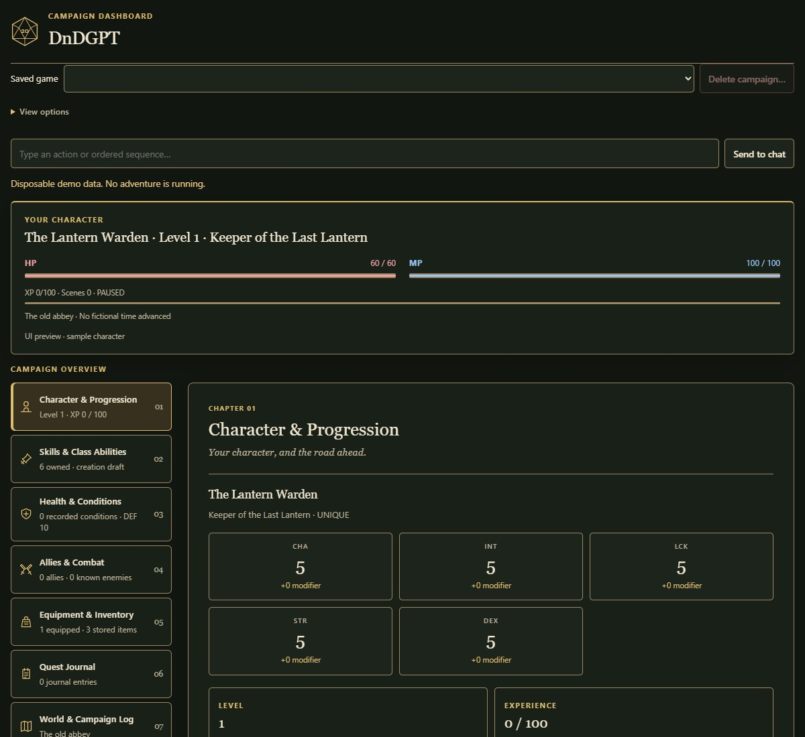
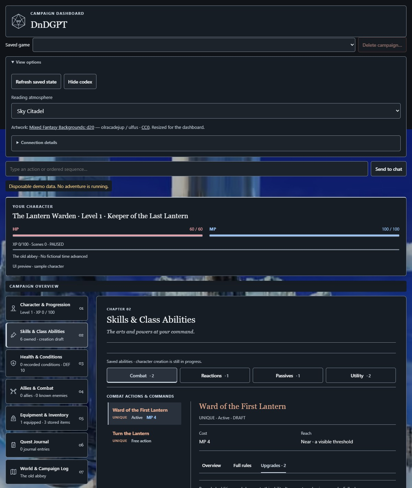
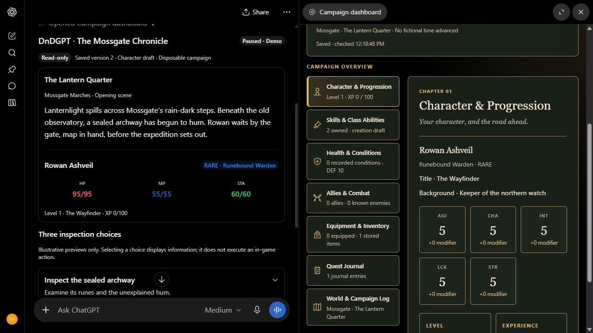
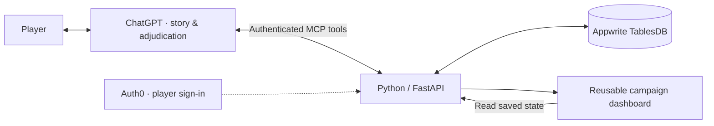

<p align="center">
  
</p>

<p align="center">
  A homebrew 5e Hack, with ChatGPT as your GM and a saved campaign dashboard.
</p>

<p align="center">
  <a href="https://deonholo.github.io/DnDGPT/">Website</a> ·
  <a href="#start-playing">Start playing</a> ·
  <a href="#what-it-does">Dashboard</a> ·
  <a href="#how-it-works">How it works</a> ·
  <a href="#faq">FAQ</a> ·
  <a href="#package-your-own-chatgpt-integration">Build your own</a> ·
  <a href="PROJECT_PROFILE.md">Portfolio & resume</a>
</p>

DnDGPT is a **5e Hack and homebrew fantasy RPG**, heavily customized around Deon Holo's taste in fantasy games. Its standalone, D&D-inspired d20 rules replace major parts of standard 5e: five attributes including Luck, HP/MP resources, rarity-based original class kits and a custom progression system. Existing 5e characters, spells and monsters need conversion. See [the rules comparison](docs/SYSTEM_IDENTITY.md).

ChatGPT runs the adventure, while a reusable dashboard tracks character stats, abilities, allies, equipment and campaign history beside the conversation.

## Start playing

**Connect DnDGPT, sign in, and start a chat.** The standard rulebook and Rule Hardener are available through the connection; no TXT uploads are needed. Your DnDGPT login keeps your campaign saves private.

**Cost and ChatGPT plans:** DnDGPT is free to use, with no DnDGPT subscription, API key or API-credit purchase required. Free ChatGPT users can play when their account offers the required plugin/custom MCP connection. A paid ChatGPT plan is recommended for longer sessions because of its larger usage allowance; normal ChatGPT model and tool limits still apply. Connection availability can vary by account and workspace, so check for the setup option below. See [OpenAI's plugin guide](https://learn.chatgpt.com/docs/plugins) and [current plans and limits](https://chatgpt.com/pricing/).

This is a one-time manual connection. DnDGPT is not listed in ChatGPT's public directory yet. Your ChatGPT account must offer **Add custom MCP server**; if that option is missing, this installation route is unavailable on your account.

### 1. Add DnDGPT to ChatGPT

Open **Plugins → + → Add custom MCP server**. Set the name to **DnDGPT**, choose **OAuth**, and paste this server URL:

```text
https://dndgpt-deonholo.fra.appwrite.run/mcp
```

### 2. Fill in the sign-in settings

Open the advanced OAuth settings. Under **Registration method**, choose **User-Defined OAuth Client**, then follow the fields in this order:

| Field | Value |
| --- | --- |
| Callback URL | Leave the default value |
| OAuth Client ID | `0vMIwqvc8C7y68Mf1P4BLMcVii38ETri` |
| OAuth Client Secret | Leave empty |
| Token endpoint auth method | **None** |
| Scopes | `campaign:read` and `campaign:write` |
| Base scopes | `offline_access` |
| OpenID Connect / OIDC | **Off** |

The OAuth Client ID is public connection information, not a password.

Leave the auto-filled **Authorization URL**, **Token URL**, and **Resource** values unchanged.

### 3. Connect and sign in

Review the requested access, click **Create as a plugin**, then **Connect**. On the DnDGPT sign-in page, choose **Continue with Google**, or **Sign up** to create an email account. If you already have DnDGPT saves, use the same sign-in method as before: Google and email accounts are not automatically linked.

That page uses Auth0 to handle DnDGPT sign-in. When ChatGPT shows **Connected**, you are ready.

Read the [Privacy Policy](https://deonholo.github.io/DnDGPT/privacy.html) and [Terms of Service](https://deonholo.github.io/DnDGPT/terms.html) before connecting. Already registered with email? Choose **Log in** rather than signing up again.

### 4. Start a campaign

Click **Try in chat** and use regular **Chat** mode. DnDGPT provides the complete standard rulebook and Rule Hardener directly. You do not need to download or attach them for standard play.

Send this to begin:

> Be my DnDGPT GM. Read the complete standard rulebook and Rule Hardener from the plugin or connected tools, then begin character creation and open my campaign dashboard. Save our progress as we play. Ask for character confirmation and starting the adventure separately.

After a saved choice, you can say **“Open my campaign dashboard.”** Updates appear when ChatGPT saves the result; narration alone does not update it.

**Managing saves:** Use the **Saved game** selector at the top of the dashboard. To remove one, select it and click **Delete campaign…**. Review the named campaign and what will be removed or retained, type its name, then choose **Delete permanently**. This cannot be undone. If a large history needs several cleanup batches, use **Continue cleanup** to finish the same deletion.

> **Thinking tip:** For character creation, level-ups and complex build decisions, try **High on Plus** or **Extra High on Pro**. **Pro effort** is another option for deeper text planning on a Pro account, but OpenAI currently lists Intelligent UI as unavailable at Pro effort; switch back to a UI-capable level for interactive choices. For regular play, try **Instant or Medium** for faster turns. These are suggestions, not requirements, and available settings depend on your account. [Model and UI availability](https://help.openai.com/en/articles/20001354-gpt-6-and-other-models-in-chatgpt).

> **Best on a desktop browser:** DnDGPT is designed for playing with the conversation and dashboard side by side. You can also play on mobile when your ChatGPT app/account supports the connection, but you switch between the chat and dashboard instead of seeing both at once.

## FAQ

- **I'm already connected. How do I start?** Click **Try in chat**, then use the starting prompt above to begin a campaign or ask the GM to open one you've already saved.
- **Do I need to download the rules?** The complete rulebook and Rule Hardener are included and available through your connection. You can start playing without attaching files or installing an extra writing plugin. If you'd like to read them yourself, open the [rulebook](https://raw.githubusercontent.com/DeonHolo/DnDGPT/main/dndgpt-app/rules/rulebook-v1.0.txt) or [Rule Hardener](https://raw.githubusercontent.com/DeonHolo/DnDGPT/main/dndgpt-app/rules/rule-hardener.txt).
- **How do I get dashboard and rule updates?** Updates are available through your existing **DnDGPT Cloud Dashboard** connection. You can keep using your saved campaigns; an open dashboard or ongoing chat may need refreshing to pick up changes.
- **How do I refresh my dashboard and rules?** In DnDGPT's settings, open **DnDGPT Cloud Dashboard → Refresh tools**. Close the dashboard and reload ChatGPT. In your campaign chat, ask: **“Read the latest complete rulebook and Rule Hardener, then reopen my saved campaign dashboard.”** The dashboard's **Refresh saved state** button reloads your campaign progress; use the connection's **Refresh tools** for updates.
- **Will an update change my character?** Your saved character and progress stay as recorded. To use new character-building rules with an existing character, ask the GM to review the changes with you while preserving your earned progress and current resources.
- **What does Reach mean?** **Engaged** means within melee reach. **Near** means reachable with one normal move along a clear route. **Far** needs extra movement or a suitable ranged ability. **Distant** needs longer travel or special movement. The GM still checks obstacles and each power's limits.
- **Can I use my own rulebook?** Attach your complete rulebook and tell the GM to use it instead of the standard rules. The dashboard can show information in its existing sections; custom mechanics may need to stay in the chat.
- **Why is my dashboard empty?** Select your campaign under **Saved game**. If character details are missing, ask the GM to save your current character choices and reopen that campaign. If it still appears empty, try the refresh steps above.

## What it does

Development plans and completed requests: [project checklist](ROADMAP.md).

- **A saved character sheet.** Resource meters, progression, conditions and saved character choices.
- **Details when you need them.** Select an ability in a compact list, then use Overview or Full rules in its inspector. Damage, HP, DEF, duration and actual costs or cooldowns stay visible; empty costs and internal bookkeeping stay out of the way. World articles use an index; the campaign log is a searchable timeline.
- **Choose your atmosphere.** Classic keeps the original dark green look by default. Open **View options → Reading atmosphere** for **33 choices**: Classic, Quiet Ink, and 31 [credited paintings and fantasy illustrations](docs/ARTWORK.md). Twenty new scenes feature character-free fantasy environments, including floating castles, mushroom caves, ancient shrines and moonlit forests. Reading panels stay dark, and your choice is saved for your account.
- **Inspect earned upgrades.** Select an ability, then open **Upgrades** for what its saved Evolutions, Background Imprints and other upgrades add or change. **Overview** gives the short description; **Full rules** holds the combined ability. Upgrades appear after the GM records them on that ability.
- **Delete campaigns from the dashboard.** Select a saved game and use **Delete campaign…** to review and permanently remove it, with a separate confirmation.
- **Durable campaign records.** Account ownership, partial updates, version checks and event history.
- **Cinematic positioning.** New standard characters use DEX. Skills show descriptive reach and readable mechanics, while the GM keeps precise movement and targeting checks behind the scenes. Moving, taking cover and spending your Action to Dash still matter.
- **Real rolls, stable receipts.** Reusable Python dice, checks and rarity tools; retrying the same action returns the saved result.
- **The rules are included.** The complete custom rulebook and originality hardener ship with the GM skill and are readable through the hosted connection. ChatGPT handles narration and most adjudication.
- **Variety starts with the class design.** The GM checks different play styles, recent motifs and naming patterns before presenting a board. The [creativity and writing guidance](docs/CREATIVITY_ENGINE.md) is included; players need no extra writing plugin.
- **Class-native Utility.** Epic and Legendary classes start with one Utility; Unique starts with two distinct Utilities. These inherit the class rarity. Independently acquired Utilities use the normal rarity procedure and the same creativity/flavor checks as other skills; Utility can have Active or Passive activation outside combat.
- **Explicit session control.** Character confirmation and starting the adventure are separate approvals. Browsing panels does not advance play.

**Classic · current dashboard**



**Choose a different atmosphere (33 choices)**



These current-interface captures use disposable sample data. Classic is the default; background artwork is optional. Existing saved atmosphere choices are preserved.

<details>
<summary>ChatGPT integration example from an earlier release</summary>



This earlier integration capture shows how desktop play pairs the chat and dashboard. Current controls, resource displays and ability readers are shown in the screenshots above.

</details>

<details>
<summary><strong>Inside the seven chapters</strong></summary>

| Chapter | Contents |
| --- | --- |
| Character & Progression | Attributes, class, title, experience and advancement |
| Skills & Class Abilities | Combat, reactions, passives and utility |
| Health & Conditions | HP, MP, defenses and status effects |
| Allies & Combat | Companions, summons, enemies and encounter records |
| Equipment & Inventory | Equipped gear, stored items and supplies |
| Quest Journal | Objectives, discoveries and rewards |
| World & Campaign Log | World reference and the story so far |

</details>

## How it works

**Python · FastAPI · JavaScript · MCP / MCP Apps · Auth0 OAuth 2.0 / PKCE · Appwrite Functions / TablesDB**



The dashboard reads **saved tool updates**, not the chat transcript. After resolving a turn, the GM calls `save_chat_update`; the dashboard reads the committed state. Narration uses regular ChatGPT. The backend has no model-inference API client.

The hosted service runs on **Appwrite Functions and TablesDB**, with Auth0 handling sign-in. Each player's saves are private to their own account.

## Package your own ChatGPT integration

This section is for developers building their own private instance. Players can start with [Start playing](#start-playing).

1. Deploy the service at a reachable HTTPS address with durable storage.
2. Configure OAuth and the matching protected resource using the [authentication guide](dndgpt-app/AUTH0_SETUP.md).
3. Create a supported custom MCP App connection in ChatGPT and sign in.
4. Copy the packaged `.app.example.json` connection template to `.app.json` beside it, replacing the placeholder with your actual App ID.
5. Build with `python dndgpt-app/scripts/build_plugin.py`, then verify saving, dashboard rendering and reopening in the actual client.

Players connecting to an existing hosted instance need only their ChatGPT account and a DnDGPT sign-in.

This repository contains source and connection templates. ChatGPT account capabilities and distribution permissions still apply.

### Run locally

Python 3.12 or newer:

```sh
python -m venv .venv
# Windows PowerShell: .\.venv\Scripts\Activate.ps1
# macOS/Linux: source .venv/bin/activate
python -m pip install -r dndgpt-app/requirements.txt
cd dndgpt-app
python -m pytest -q
python -m uvicorn app.server:app --host 127.0.0.1 --port 8765
```

Health: `http://127.0.0.1:8765/api/health`. Protected tools require OAuth configuration. Starting localhost alone does not connect it to ChatGPT.

For a **disposable UI simulator**, run from `dndgpt-app`:

```sh
python -m uvicorn tests.host_harness:app --host 127.0.0.1 --port 8766
```

Open `http://127.0.0.1:8766/test-host`. It uses generated test credentials and a temporary database. Keep it local. It tests UI behavior separately from ChatGPT compatibility.

## Validation and scope

Automated tests cover authentication, ownership, transactional updates, duplicate retries, saved rolls, recovery, rule integrity and packaging. Browser interaction checks and hosted ChatGPT acceptance are recorded separately in the [acceptance notes](dndgpt-app/CLIENT_ACCEPTANCE.md).

Current evidence does not establish production uptime, player capacity, measured latency, complete executable rule coverage or public-directory approval. Credentials, private connection IDs, campaign databases and personal playthroughs are excluded from this repository.

## Project map

| Path | Purpose |
| --- | --- |
| `dndgpt-app/app/` | API, MCP tools, storage and dashboard |
| `dndgpt-app/rules/` | Complete rules, amendments and integrity manifest |
| `dndgpt-app/tests/` | Automated checks and disposable host simulator |
| `dndgpt-app/scripts/` | Packaging, rule audits and backup tools |
| [PROJECT_PROFILE.md](PROJECT_PROFILE.md) | Architecture history, skills and resume wording |

Created by **Deon Holo**, with AI-assisted development using Codex and ChatGPT. See [CHAT_LED_PLAY.md](dndgpt-app/CHAT_LED_PLAY.md) and [RULES_COVERAGE.md](dndgpt-app/RULES_COVERAGE.md) for implementation detail.

## License

Application code is [MIT licensed](LICENSE). Deon Holo's original rulebook and documentation use [CC BY 4.0](LICENSE-CONTENT.md), allowing reuse and adaptations with credit. Artwork and other third-party material keep their own terms; see [licensing details](LICENSING.md) and [art credits](docs/ARTWORK.md).

## Support development

[](https://www.paypal.com/paypalme/deonholo)

Contributions are optional and do not unlock features or affect gameplay.

Logo downloads: [transparent PNG](docs/images/dndgpt-logo.png) · [dark square PNG](docs/images/dndgpt-logo-dark.png) · [SVG](docs/images/dndgpt-dice.svg).
